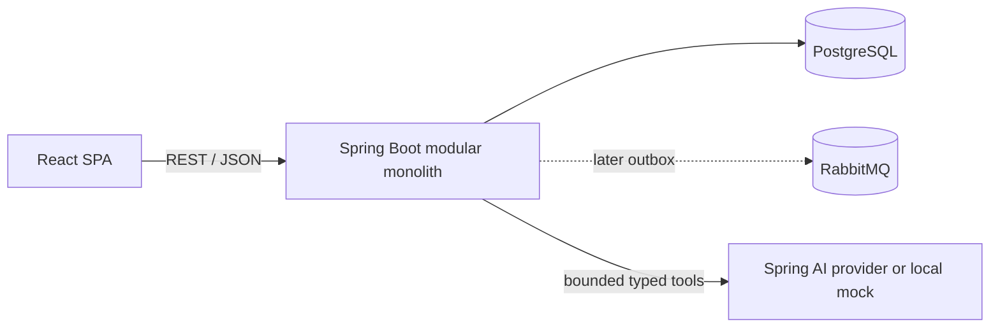

# StockFlow AI

**AI-Powered Business Intelligence & Commerce Operations Platform**

StockFlow AI is a production-style portfolio project for running product, inventory, order, analytics, and operational decision workflows in one multi-tenant application. Its AI capabilities are designed as a bounded layer over deterministic business services: the commerce platform remains functional when a model provider is unavailable, and consequential actions require human approval.

Phases 0–6 are implemented: architecture, runnable commerce, the authenticated operations UI, deterministic analytics, a secure AI Data Analyst, provider reliability hardening, and evidence-backed Business Insights. Phase 7 operational execution has not started.

## What works now

- Java 21 / Spring Boot 4.1 API with session authentication, CSRF, Problem Details errors, and server-derived store context.
- ADMIN/STAFF ownership, store membership management, and cross-store isolation.
- Product CRUD/search/archive, store-local SKU uniqueness, inventory adjustments/audit/low-stock views, and atomic reservations.
- Idempotent orders with item snapshots, mock payment, cancellation/expiration, explicit state transitions, and transactional outbox events.
- PostgreSQL configuration and Flyway migrations for identity, commerce, inventory, orders, idempotency, and outbox state.
- React 19 / TypeScript / Vite operations console with protected routes, session-expiry handling, React Router, and TanStack Query.
- Responsive dashboard, product catalog, inventory/audit workflows, order creation/payment/cancellation, ADMIN team settings, and live analytics navigation.
- Store-time-zone-aware revenue/order/AOV/unit metrics, previous-period comparisons, gap-filled revenue trends, product/category rankings, and inventory velocity/coverage risk.
- A responsive Recharts analytics workspace with presets, custom half-open date filters, comparison controls, KPI cards, charts, rankings, alerts, and explicit loading/empty/error states.
- A persisted AI Copilot with a deterministic local provider, optional Spring AI/OpenAI tool calling, eight allow-listed analytics tools, bounded follow-up context, KPI/chart/table responses, evidence, and safe tool audits.
- Deterministic server-side response assembly: every authoritative number comes from the Phase 4 analytics engine, never model-generated prose.
- Bounded provider retries/timeouts, mock-server fault injection, privacy-minimized token/cost telemetry, and an explicitly opt-in live evaluation.
- Deterministic revenue/product/category and price-volume decomposition, inventory diagnostics, bounded what-if scenarios, and server-grounded findings.
- Versioned Business Analysis reports with evidence-linked hypotheses/recommendations, PostgreSQL JSONB persistence, idempotency, and role-aware history.
- A professional Business Insights workspace with report creation/history, verified KPI cards, charts, evidence ledger, scenarios, recommendations, and limitations.
- Central typed API client with cookie credentials, CSRF bootstrap, Problem Details errors, and mutation-driven cache invalidation.
- Backend unit/MVC/migration tests and PostgreSQL Testcontainers concurrency/rollback/search tests, frontend service/component tests, and a real-stack Playwright commerce flow.
- Reproducible Maven and pnpm builds, production-style containers, Compose health checks, and GitHub Actions CI.
- Architecture, ER model, API, AI guardrails, KPI definitions, testing, deployment, and decision documentation.

## Architecture at a glance

The backend is a package-by-feature modular monolith backed by PostgreSQL. Phase 2 writes a transactional outbox; a RabbitMQ relay is deferred until a later milestone has an actual consumer. The AI orchestrator can invoke only typed, authorized, bounded tools; deterministic services own metrics and mutations.



See [system architecture](docs/architecture.md), [database design](docs/database-design.md), and [engineering decisions](docs/engineering-decisions.md).

## Quick start with Docker

Prerequisite: a current Docker Desktop/Engine with Docker Compose v2.

```bash
cp .env.example .env
docker compose up --build
```

Then open:

- Web application: <http://localhost:5173>
- API health: <http://localhost:8080/api/health>
- Spring Actuator health: <http://localhost:8080/actuator/health>

The checked-in development defaults work without an AI key. Stop with `docker compose down`. To also remove the local database volume, intentionally run `docker compose down --volumes` (this deletes local data).

## Host-native development

Prerequisites:

- JDK 21 (`java -version` must report 21)
- Node.js 22.12+ or 24+
- pnpm 11.25 (Corepack: `corepack enable && corepack prepare pnpm@11.25.0 --activate`)
- PostgreSQL 18, or run only PostgreSQL with `docker compose up postgres`

Start the backend:

```bash
cd backend
POSTGRES_PASSWORD=stockflow_dev_password ./mvnw spring-boot:run
```

Start the frontend in another terminal:

```bash
cd frontend
pnpm install --frozen-lockfile
pnpm dev
```

Vite proxies `/api` to `http://localhost:8080`. Override the development target with `VITE_DEV_API_TARGET`; keep secrets out of all `VITE_` variables because they are exposed to the browser.

## Tests and builds

Backend:

```bash
cd backend
./mvnw verify
```

`verify` includes PostgreSQL Testcontainers integration tests and therefore requires a running Docker daemon. The Phase 6 verification ran 159 fast/unit/web/migration/evaluation/fault tests and 14 non-billable integration tests (173 passed total); the one live-provider evaluation was discovered and skipped by default.

Frontend (strict type-check, zero-warning lint, 37 tests, production build):

```bash
cd frontend
pnpm install --frozen-lockfile
pnpm check
```

Browser E2E (requires the running Compose stack and installed Chromium):

```bash
cd frontend
pnpm exec playwright install chromium
pnpm test:e2e
```

Integrated stack:

```bash
docker compose up --build --wait
curl --fail http://localhost:8080/api/health
```

The Spring smoke test uses an in-memory database for wiring, and Flyway migrations are syntax-checked against H2 PostgreSQL mode. PostgreSQL-specific schema validation, transaction rollback, idempotency, tenant isolation, and concurrency behavior run against PostgreSQL 18 with Testcontainers.

## Database migrations

Flyway runs automatically when the backend starts. Migration files live in `backend/src/main/resources/db/migration`; never edit an applied migration—add the next version instead. Hibernate is configured to validate, not create, production schema.

To inspect migration status with a configured database:

```bash
cd backend
./mvnw flyway:info
```

## Configuration

Copy `.env.example` for local Compose overrides. Development defaults are intentionally non-production. Production credentials belong in a managed secret store and must never be committed or placed in frontend variables.

| Variable | Purpose | Default |
|---|---|---|
| `POSTGRES_DB` | Database name | `stockflow` |
| `POSTGRES_USER` | Database user | `stockflow` |
| `POSTGRES_PASSWORD` | Development database password | `stockflow_dev_password` |
| `POSTGRES_PORT` | Host database port | `5432` |
| `BACKEND_PORT` | Host API port | `8080` |
| `FRONTEND_PORT` | Host web port | `5173` |
| `VITE_DEV_API_TARGET` | Vite-only backend proxy target | `http://localhost:8080` |
| `VITE_API_BASE_URL` | Optional browser-visible API base; blank uses the same origin | blank |
| `AI_PROVIDER` | AI gateway: `mock` or `openai` | `mock` |
| `AI_MODEL` | Spring AI/OpenAI Chat Completions model | `gpt-4o-mini` |
| `OPENAI_API_KEY` | Server-only key required when provider is `openai` | blank |
| `AI_TIMEOUT` | Provider request timeout | `20s` |
| `AI_RETRY_MAX_ATTEMPTS` | Total transient provider attempts | `2` |
| `AI_RETRY_INITIAL_BACKOFF` | First retry delay | `200ms` |
| `AI_RETRY_BACKOFF_MULTIPLIER` | Exponential delay multiplier | `2` |
| `AI_RETRY_MAX_BACKOFF` | Maximum retry delay | `1s` |
| `AI_MAX_TOOL_CALLS` | Maximum tools in one request | `6` |
| `AI_MAX_RESPONSE_TOKENS` | Provider output-token cap | `1200` |
| `AI_MAX_QUESTION_LENGTH` | Normalized question character cap | `1000` |
| `AI_MAX_HISTORY_MESSAGES` | Prior messages sent as context | `12` |
| `AI_MAX_RESPONSE_CHARACTERS` | Persisted structured-response cap | `50000` |
| `AI_PRICING_VERSION` | Version label for cost estimates | `2026-10-22` |
| `AI_PRICING_MODEL` | Exact model covered by configured rates | `gpt-4o-mini` |
| `AI_INPUT_USD_PER_MILLION` | Estimated input-token rate | `0.15` |
| `AI_OUTPUT_USD_PER_MILLION` | Estimated output-token rate | `0.60` |
| `BUSINESS_ANALYSIS_RETENTION_DAYS` | Development retention marker; does not delete reports | `90` |
| `BUSINESS_ANALYSIS_MAX_CONTRIBUTION_ROWS` | Maximum contribution/evidence rows per report section | `50` |
| `BUSINESS_ANALYSIS_PROMPT_VERSION` | Version label for bounded synthesis instructions | `business-analysis-v1` |
| `SESSION_COOKIE_SECURE` | Mark session cookies Secure behind HTTPS | `false` locally |

Mock mode is fully local and exercises the real tool, analytics, persistence, audit, and response paths. For explicit real-provider testing, set `AI_PROVIDER=openai`, a compatible `AI_MODEL`, and `OPENAI_API_KEY` only in the server environment. Never put an API key in a `VITE_` variable.

The billable live evaluation remains disabled unless `RUN_LIVE_AI_EVAL=true`; see [AI evaluation](docs/ai-evaluation.md) for its three-request and cost limits. Telemetry cost is a versioned estimate, not the provider's billed amount.

## Troubleshooting

- **`docker: command not found` after installing Docker Desktop on macOS:** start Docker Desktop, then add its CLI directory for the current shell with `export PATH="/Applications/Docker.app/Contents/Resources/bin:$PATH"`.
- **Backend fails before startup:** confirm Java 21, PostgreSQL readiness, credentials, and whether ports 5432/8080 are free. Use `docker compose logs postgres backend`.
- **Frontend shows API unavailable:** open `/api/health` through the same frontend origin, then check the backend. For native Vite development, confirm `VITE_DEV_API_TARGET`.
- **Flyway validation error:** do not rewrite migration history. Restore the expected database or add a forward migration.
- **Port conflict:** change `POSTGRES_PORT`, `BACKEND_PORT`, or `FRONTEND_PORT` in `.env`.
- **Architecture mismatch on container pulls:** use current multi-architecture images and a supported Docker version.

## Documentation map

- [Requirements](docs/requirements.md)
- [Implementation plan and acceptance criteria](docs/implementation-plan.md)
- [Architecture and repository structure](docs/architecture.md)
- [Database ER model and indexes](docs/database-design.md)
- [API contract](docs/api-design.md)
- [AI orchestration and safety](docs/ai-architecture.md)
- [AI tool contracts](docs/ai-tool-contracts.md)
- [AI evaluation](docs/ai-evaluation.md)
- [Business analysis design](docs/business-analysis-design.md)
- [Business analysis evaluation](docs/business-analysis-evaluation.md)
- [Business report schema](docs/report-schema.md)
- [KPI definitions](docs/kpi-definitions.md)
- [Testing strategy](docs/testing-strategy.md)
- [Deployment direction](docs/deployment.md)
- [Engineering decision log](docs/engineering-decisions.md)

## Analytics demo data and benchmark

After registering a store, copy its store/user UUIDs from `/api/auth/me`, then seed the isolated store with six products and 120 deterministic orders:

```bash
docker compose exec -T postgres psql -U stockflow -d stockflow \
  -v store_id=YOUR_STORE_UUID -v user_id=YOUR_USER_UUID \
  -f /dev/stdin < scripts/seed/analytics-demo.sql
```

Use `scripts/seed/analytics-demo-reset.sql` with `store_id` to remove only `DEMO-*` records. The k6 workflow is `scripts/performance/analytics-smoke.js`; it creates its own isolated tenant with 100 paid orders by default, preserves each virtual user's session cookie, and measures five analytics endpoints. Override `DATASET_ORDERS`, `VUS`, or `DURATION` when profiling a different local shape.

## Next milestone: Phase 7

Phase 7 may convert selected advisory recommendations into explicit proposals with approval, authorization/freshness revalidation, idempotent execution, and audit history. It has not started. Phase 6 reports are read-only and cannot change inventory, prices, purchasing, or orders.
