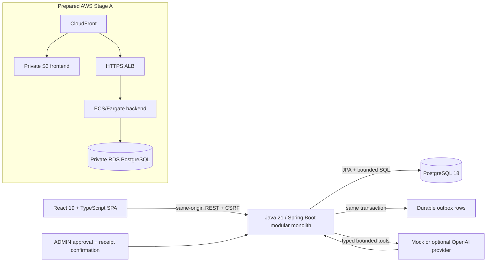
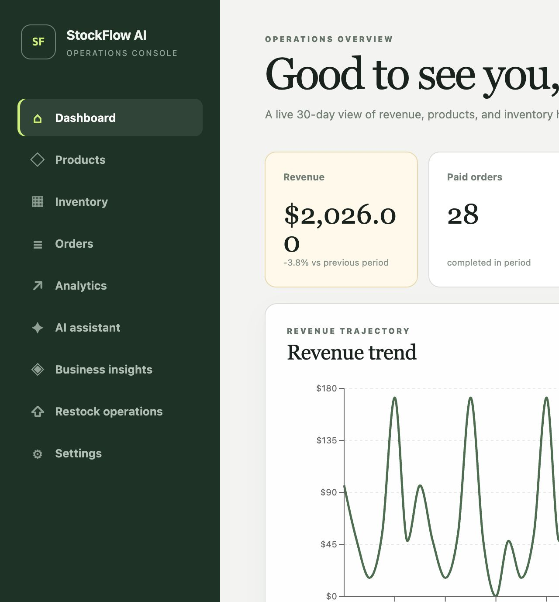
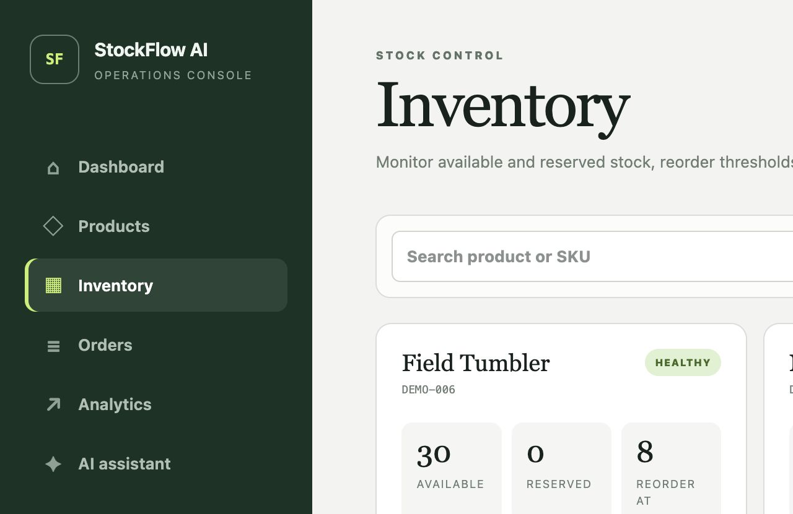
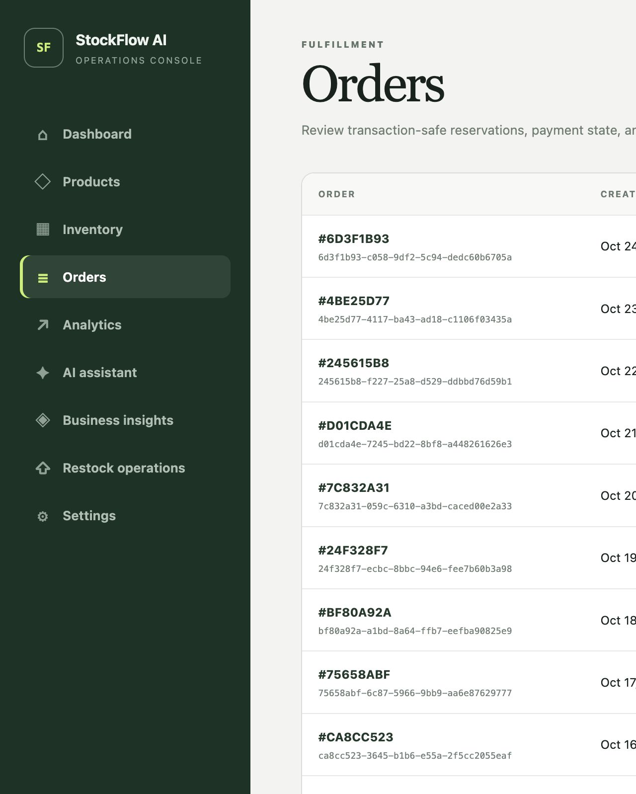
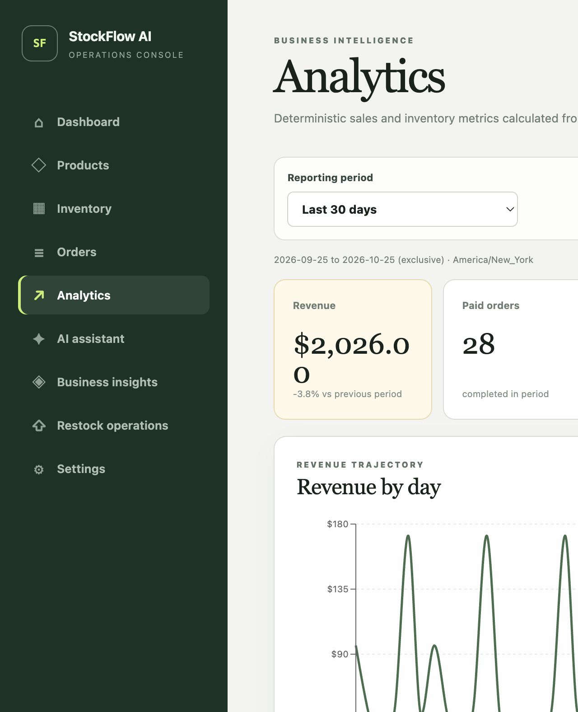
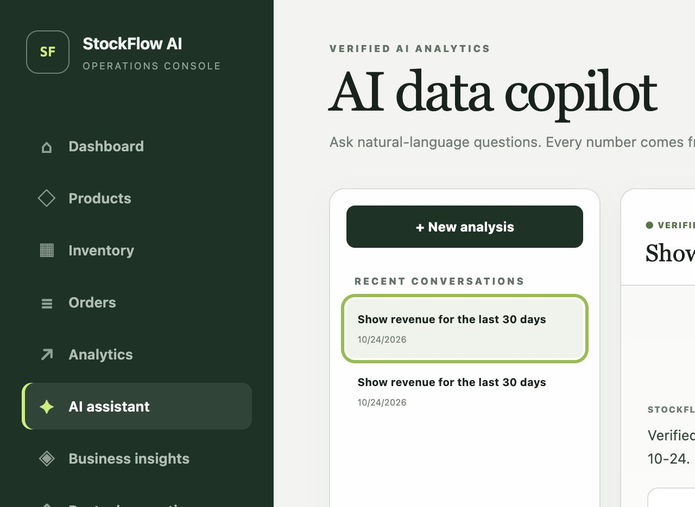
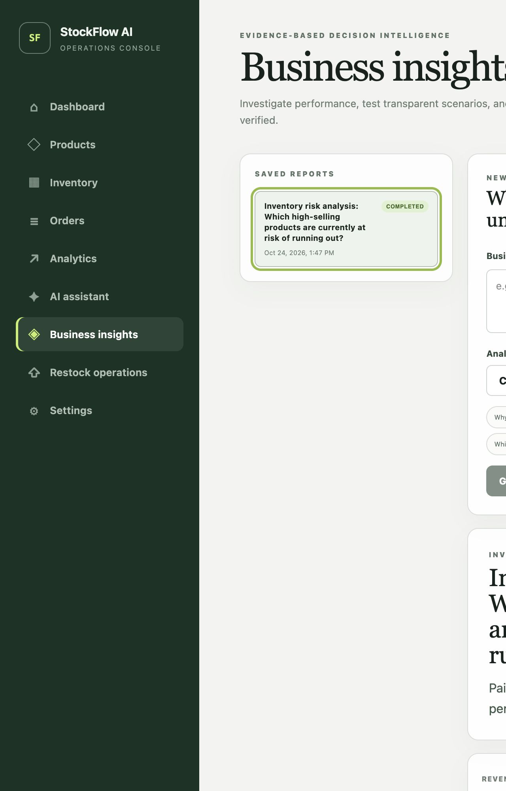
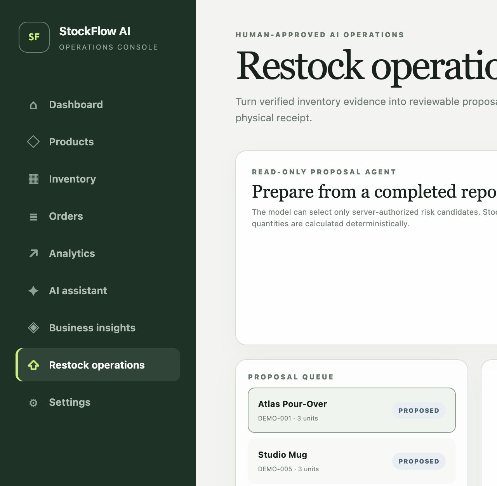

# StockFlow AI — Full-Stack Commerce Operations & AI Business Intelligence Platform

StockFlow AI is a production-style Java/React platform for running catalog,
inventory, order, analytics, and approval-based restock workflows in one
multi-tenant system. It was motivated by operational challenges encountered
while running a K-Pop merchandise business with historical experience across
30,000+ transactions and 200+ SKUs. The portfolio application uses synthetic
data and does not integrate with or process live store orders.

AI is intentionally outside the correctness boundary: deterministic backend
services calculate every financial metric, the model can call only typed and
bounded tools, core commerce remains available during provider outages, and an
authenticated ADMIN must approve and explicitly confirm any inventory receipt.

## Engineering snapshot

- **44 REST method/route endpoints** across authentication, commerce,
  analytics, AI reporting, and operations.
- **245 automated cases discovered; 244 executed and passed**, with only the
  explicitly billable live-provider evaluation skipped.
- PostgreSQL row locking, deterministic lock order, conditional inventory
  updates, transaction rollback, and idempotency prevent overselling and
  duplicate order/receipt effects.
- Local mixed workload: **225.07 requests/second**, 0% errors, **4.32 ms p50,
  26.74 ms p95, and 83.22 ms p99** under the documented five-VU profile.
- Route splitting reduced initial production JavaScript from **777.47 kB to
  257.19 kB minified**; automated budgets prevent regression.
- AWS deployment, OIDC CD, monitoring, synthetic demo bootstrap, and teardown
  are prepared as code but **no public environment has been provisioned**.

See [verified engineering metrics](docs/engineering-metrics.md), the
[Phase 8 verification record](docs/phase8-verification.md), and the
[Phase 9 Stage A verification](docs/phase9-verification.md).

## Key features

- Product catalog, store-local SKUs, inventory adjustments, audit history, and
  low-stock views.
- Idempotent orders, immutable line snapshots, atomic reservation/release,
  payment/cancellation state transitions, and transactional outbox records.
- Store-time-zone-aware revenue, AOV, order, unit, product, category, velocity,
  days-of-cover, and inventory-risk analytics.
- AI Data Analyst with eight allow-listed read-only tools and server-assembled
  KPI, chart, table, filter, and evidence responses.
- Evidence-backed Business Analysis reports with deterministic decomposition,
  scenarios, hypotheses, recommendations, limitations, JSONB persistence, and
  creator/store authorization.
- AI-assisted restock proposals with explicit ADMIN approval, evidence and
  inventory freshness checks, physical-receipt confirmation, command
  idempotency, audit history, and lease recovery.
- Request correlation, safe operational logs, health probes, bounded retries,
  provider usage/cost telemetry, login throttling, and tenant isolation.

## Architecture



The backend is a package-by-feature modular monolith. Controllers validate API
DTOs, services own business rules and transactions, repositories own
persistence, and `StoreContext` supplies authorization scope from the server
session—never from a client or model-provided store ID.

The outbox currently guarantees atomic durable recording only. No consumer
exists, so a broker and relay are deliberately absent rather than presented as
unused architecture. See [system architecture](docs/architecture.md),
[AI architecture](docs/ai-architecture.md), and
[Phase 7 operations design](docs/phase7-architecture.md).

## Working application

These are screenshots of the local application running against PostgreSQL and
synthetic data, not generated mockups.

| Dashboard | Products and inventory |
|---|---|
|  |  |
| Orders | Analytics |
|  |  |
| AI Copilot | Business Insights |
|  |  |
| Operations proposals | |
|  | |

## Technical stack

| Layer | Implemented technology |
|---|---|
| Backend | Java 21, Spring Boot 4.1, Spring Security, Spring Data JPA, Bean Validation, Actuator, Micrometer |
| Database | PostgreSQL 18, Flyway V1–V9, NUMERIC money, TIMESTAMPTZ, JSONB, row/optimistic locks |
| AI | Spring AI 2.0, deterministic mock, optional OpenAI adapter, typed tool calling, bounded retries/telemetry |
| Frontend | React 19, TypeScript 5.9, Vite 8, React Router, TanStack Query, Recharts, Tailwind tooling |
| Verification | JUnit 5, MockMvc, Testcontainers, Vitest, Testing Library, Playwright, k6 |
| Delivery | Multi-stage Docker, Compose, GitHub Actions, Dependabot, prepared Terraform for AWS |

## Run locally

Prerequisite: current Docker Engine/Desktop with Compose v2.

```bash
cp .env.example .env
docker compose up --build --wait
```

Open <http://localhost:5173>. The default provider is deterministic and needs no
API key. Flyway initializes PostgreSQL automatically. Stop without deleting data
using `docker compose down`; `docker compose down --volumes` intentionally
deletes the local database.

To load historical synthetic analytics data, register a local store, obtain its
store/user UUIDs from `/api/auth/me`, then run:

```bash
docker compose exec -T postgres psql -U stockflow -d stockflow \
  -v store_id=YOUR_STORE_UUID -v user_id=YOUR_USER_UUID \
  -f /dev/stdin < scripts/seed/analytics-demo.sql
```

The paired `scripts/seed/analytics-demo-reset.sql` removes only scoped
`DEMO-*` fixtures. See [seed instructions](scripts/seed/README.md).

### Host development

Use JDK 21, Node 22.12+/24+, pnpm 11.25, and PostgreSQL 18. Start the backend
with `cd backend && POSTGRES_PASSWORD=... ./mvnw spring-boot:run` and the frontend
with `cd frontend && pnpm install --frozen-lockfile && pnpm dev`.

## Test and build

```bash
cd backend && ./mvnw verify
cd ../frontend && pnpm install --frozen-lockfile && pnpm check
pnpm test:e2e                    # with the Compose stack running
```

The backend gate includes real PostgreSQL Testcontainers tests for tenant
isolation, concurrent last-item reservations, same-key order creation,
payment/cancellation races, rollback, report persistence/recovery, stale
proposals, and duplicate receipt execution. Default CI uses mock AI and makes no
billable call. Exact discovered/executed counts are maintained in
[engineering-metrics.md](docs/engineering-metrics.md); performance methodology
and limitations are in [performance-report.md](docs/performance-report.md).

## Security model

- BCrypt password hashing, server sessions, fixation protection, secure cookies
  in production, CSRF on mutations, and bounded login failures.
- ADMIN/STAFF rules and every tenant lookup enforced server-side through
  authenticated store context; cross-store IDs return not found.
- Model tools cannot choose a store, execute SQL, calculate authoritative money,
  approve proposals, or mutate inventory.
- Production public registration defaults off. Demo credentials remain private,
  AI defaults to mock, request sizes are bounded, and secrets stay server-side.
- Prepared AWS networking keeps PostgreSQL private and the ALB restricted to
  CloudFront plus a secret origin header.

This is an engineering security review, not a penetration test or compliance
certification. See [security review](docs/security-review.md) and
[cloud architecture](docs/cloud-architecture.md).

## Deployment status

Phase 9 Stage A is prepared: production profiles, private-network Terraform,
OIDC/manual CD, budgets, alarms, backup/rollback instructions, synthetic demo
bootstrap, and post-deployment checks. No AWS resource, public URL, or domain was
created. A live demo link will be added only after explicit cost/public-exposure
approval and successful Stage B verification.

- [Cost and safety gate](docs/deployment-cost-estimate.md)
- [Deployment checklist](docs/deployment-checklist.md)
- [Operations runbook](docs/operations-runbook.md)
- [Demo walkthrough](docs/demo-script.md)

## Engineering trade-offs and future work

- Add shared sessions and distributed/edge throttling before running multiple
  backend tasks.
- Upgrade to Multi-AZ RDS only when availability requirements justify cost.
- Add an outbox relay only after a named asynchronous consumer exists.
- Add backend/image SCA with an approved triage policy and run a formal security
  assessment before representing the system as production-ready.
- Run the opt-in live-provider evaluation only with a separately approved key
  and budget; real-provider behavior is currently unverified.
- Historical inventory forecasting, causal inference, supplier purchasing, and
  autonomous execution are intentionally unimplemented.

For deeper review, start with the [implementation plan](docs/implementation-plan.md),
[decision log](docs/engineering-decisions.md),
[testing strategy](docs/testing-strategy.md), and
[General SDE interview guide](docs/sde-interview-guide.md).
