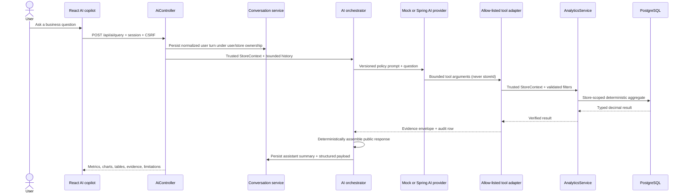

# Phase 5 AI Data Analyst Architecture

## Safety and correctness principle

The model interprets intent and may choose from an allow-list. It never receives database credentials, writes SQL, supplies tenant identity, computes authoritative financial numbers, or mutates commerce state. The server builds every metric, chart, table, filter, and evidence reference from typed Phase 4 analytics results; provider prose is not trusted as a source of numeric claims.

## Request flow

## Implemented components

- `AiController`: authenticated endpoints and request/list-limit validation.
- `AiAnalyticsService`: conversation-turn application service.
- `AiChatOrchestrator`: request lifecycle, provider call, execution collection, deterministic assembly, metrics, and safe structured logs.
- `AiProviderGateway`: provider-neutral boundary.
- `MockAiProviderGateway`: default deterministic/offline provider used by development, CI, E2E, and demos.
- `SpringAiProviderGateway`: opt-in Spring AI/OpenAI adapter using tool calling and trusted `ToolContext`.
- `AiProviderFailureClassifier`: stable timeout, rate-limit, malformed-response, and unavailable error mapping.
- `AiRequestTelemetryLogger`: best-effort, request-level usage/latency/cost persistence and Micrometer measurements.
- `AnalyticsToolAdapter`: eight typed, read-only, allow-listed analytics tools.
- `AiResponseAssembler`: converts typed tool results into the stable public schema and ignores provider-authored numeric claims.
- `AiConversationService`: owns conversation/message persistence, bounded context, titles, and owner-scoped retrieval.
- `AiToolExecutionLogger`: persists safe filter metadata and status in an independent short transaction.

The versioned policy prompt is `backend/src/main/resources/prompts/ai-data-analyst-v1.txt`. Prompt changes are code-reviewed and tested like other behavior.

## Tool contract

| Model-visible tool | Deterministic service operation | Bound |
|---|---|---|
| `get_revenue_summary` | Revenue, paid orders, AOV, units | 366-day period resolver |
| `compare_revenue` | Current and equal-length prior revenue | 366-day period resolver |
| `get_revenue_trend` | Gap-filled day/week/month series | 366-day period resolver |
| `get_top_selling_products` | Revenue-ranked snapshot products | 1–50 rows |
| `get_sales_by_category` | Snapshot category performance | 366-day period resolver |
| `get_order_statistics` | Stable revenue/order overview contract | 366-day period resolver |
| `get_inventory_summary` | Current stock plus period velocity | 366-day period resolver |
| `get_inventory_risk` | Stock, velocity, coverage, risk | 1–100 rows |

Tool parameters contain only allow-listed presets, optional ISO dates, intervals, comparison flags, and bounded limits. `storeId`, `userId`, role, database identifiers, and credentials are absent. The adapter takes those values from the authenticated `StoreContext` passed outside model-visible arguments through Spring AI `ToolContext`.

## Provider selection

`AI_PROVIDER=mock` is the default and needs no external service or key. It uses deterministic intent rules and invokes exactly the same tool adapter, analytics services, persistence, response assembly, and audit path as production.

`AI_PROVIDER=openai` activates the pinned Spring AI 2.0.1 adapter with `OPENAI_API_KEY` and `AI_MODEL` (default `gpt-4o-mini`). Model changes are explicit configuration changes and must pass the optional live evaluation; StockFlow does not silently move to a provider's newest model.

Relevant primary documentation: [Spring AI getting started](https://docs.spring.io/spring-ai/reference/getting-started.html), [Spring AI tool calling](https://docs.spring.io/spring-ai/reference/api/tools.html), [Spring AI OpenAI chat](https://docs.spring.io/spring-ai/reference/api/chat/openai-chat.html), and [OpenAI function calling](https://developers.openai.com/api/docs/guides/function-calling).

## Stable response contract

`AiResponse` contains:

- `responseType`: `ANALYTICS`, `CLARIFICATION`, or `UNSUPPORTED`;
- `summary`: deterministic concise statement;
- typed `metrics`, `charts`, and `tables`;
- `evidence` linking each result to its tool execution and exact half-open period;
- explicit `assumptions`, `limitations`, and `appliedFilters`;
- `conversationId`, `messageId`, and provider label.

The browser never parses free-form model prose into a chart or KPI. Unknown structured fields remain additive for compatibility.

## Persistence and ownership

Flyway V4 adds `ai_conversations`, `ai_messages`, and `ai_tool_executions`; V5 adds `ai_request_telemetry`. Conversations are owned by both authenticated user and store; listing and lookup include both values so another member or tenant receives the same not-found behavior as a missing ID. Messages carry store ownership and retain the validated response payload. Tool audit rows capture request/conversation/message IDs, user/store attribution, tool name, status, duration, safe filter metadata, and a stable error code.

No prompt, API key, session cookie, raw tool result, or database credential is written to the tool audit log. Conversation context is capped at 12 prior messages and query/result lengths are bounded.

Conversation rows use optimistic versions. If two requests try to extend one conversation simultaneously, a conflicting update returns `409 CONCURRENT_MODIFICATION`; it cannot silently overwrite the other turn. Successful assistant persistence and the conversation timestamp update share a transaction, while tool audit rows use `REQUIRES_NEW` so failure evidence survives a failed tool/provider turn.

## Failure, retry, and outage isolation

- Provider transport connect/read/write/request timeouts default to 20 seconds.
- The OpenAI SDK retry count is zero. `SpringAiProviderGateway` owns the only retry loop: two total attempts by default, transient failures only, 200 ms initial delay, multiplier 2, and 1 second maximum delay. This avoids multiplicative retry stacks.
- Retryable cases are timeouts, resets/interrupted transport, 429, and 500/502/503/504. Malformed provider content and non-retryable client errors fail immediately.
- A retry restarts the in-memory tool-result collection. The available tools are read-only analytics queries, so a repeated attempt cannot duplicate a commerce mutation.
- Maximum total tool calls defaults to 6; per-tool and result-row limits are enforced independently.
- Questions default to 1,000 characters and persisted response JSON to 50,000 characters.
- Timeout maps to `504 AI_PROVIDER_TIMEOUT`, malformed content to `502 AI_PROVIDER_MALFORMED_RESPONSE`, rate limiting to a safe `503 AI_PROVIDER_RATE_LIMITED`, and other outages to `503 AI_PROVIDER_UNAVAILABLE`.
- Commerce and direct analytics do not call the provider and remain available during AI failure; an automated outage-isolation integration test verifies product/inventory state is unchanged.
- Tool failures are audited with safe error codes and rethrown; malformed or unauthorized data fails closed.

## Request telemetry and cost semantics

Each request records owner IDs, provider/model, success/failure, provider-reported input/output/total tokens when available, tool-call count, total duration, estimated cost, pricing version, and safe error code. It does not store question text, response text, API keys, cookies, or raw business results. The write uses an independent transaction and is best effort: a telemetry database failure increments `stockflow.ai.telemetry.errors` but does not replace a successful AI response.

Estimated cost is `(input_tokens × input_rate + output_tokens × output_rate) / 1,000,000` using `AI_PRICING_*` configuration. It is not an invoice or actual billed cost. If the returned model does not exactly match the configured pricing model, tokens are retained and cost is `null` rather than guessed.

Micrometer records request duration/error status, provider duration, tool count/latency, token counts, estimated cost, and telemetry-write failures. Labels are deliberately low-cardinality provider/model/status values. Logs include request/store IDs, provider/model, counts, estimated cost and pricing version, response type or safe error code—never prompts, credentials, or result payloads.

## Evaluation strategy

The checked-in evaluation fixture contains 56 representative business and unsupported prompts across revenue, comparison, trend, product, category, order, inventory, and risk intents. Parameterized tests also cover follow-up context. Separate unit tests prove tool bounds/trusted context and that malicious provider text cannot replace verified numbers. PostgreSQL integration proves persisted follow-up conversation behavior, audit/telemetry records, exact metric values, and cross-tenant isolation. A mock HTTP server verifies provider faults and bounded attempts. The live provider suite is class-level opt-in and is not required for deterministic CI.

Phase 6 extends the same gateway for report synthesis. It sends only server-built aggregate signals, accepts only allow-listed hypothesis/recommendation codes, and constructs every number, evidence link, chart, and final text template on the server. Provider failure leaves a `FAILED` report without a fabricated document. See [business analysis design](business-analysis-design.md) and [report schema](report-schema.md). Operational proposals, approvals, and mutations remain Phase 7.
