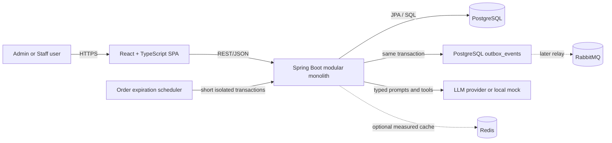
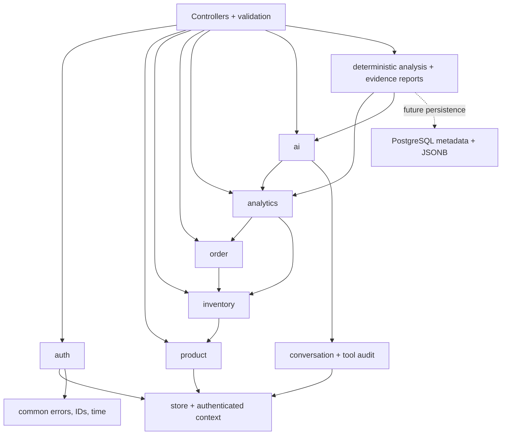
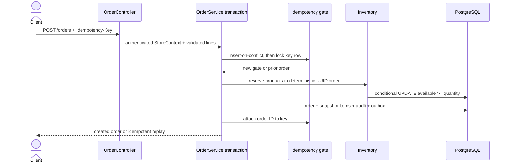
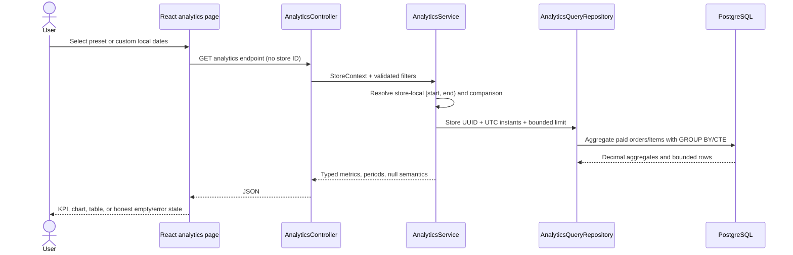
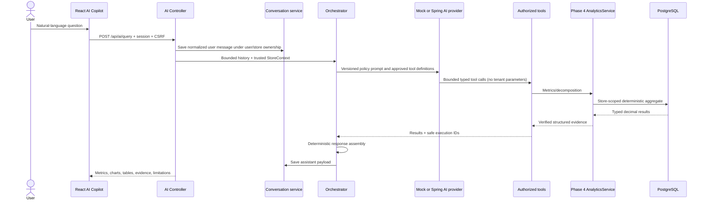

# System Architecture

## Context and containers



Phase 2 expires orders with an in-process scheduled scanner and persists order events atomically in PostgreSQL. RabbitMQ and an outbox relay remain a later addition when an actual asynchronous consumer exists; this avoids operating an unused broker without weakening event durability. Redis is also absent until a measured need exists. An LLM outage disables synthesis, not commerce or deterministic analytics.

Phase 3 keeps the browser deliberately thin: it owns navigation, forms, request state, and presentation, while the backend remains authoritative for tenant scope, permissions, validation, prices, inventory, state transitions, and idempotency.

Phase 4 keeps analytics in the same modular monolith. Controllers accept only bounded reporting filters; `AnalyticsPeriodResolver` converts store-local dates to UTC half-open instants; `AnalyticsService` owns formulas/comparisons and exposes future AI-ready operations; `AnalyticsQueryRepository` pushes grouping and filtering into PostgreSQL. No analytics endpoint accepts a store ID.

Phase 5 adds an AI interpretation layer without changing that correctness boundary. A deterministic mock is the default; the optional Spring AI/OpenAI adapter and the mock both invoke the same allow-listed tool adapter. Final public metrics and visualizations are assembled server-side from typed analytics results, never from model prose.

Phase 6 implements evidence-backed analysis inside the monolith. Reports use PostgreSQL relational metadata plus a validated, versioned JSONB document. Server-derived authorization allows store ADMIN users to access all reports in their store and STAFF users to access only reports they created; every lookup remains store-scoped. A configurable 90-day retention value is a development default only, with no automatic deletion until lifecycle, audit, backup, and compliance policies are approved.

## Backend module boundaries



Dependencies flow through public service interfaces; controllers do not access repositories from another feature. Cross-feature database changes are coordinated by one application transaction.

## Phase 2 request and ownership flow

1. `GET /api/auth/csrf` creates a CSRF cookie and returns the request token.
2. Registration atomically creates a user, store, and ADMIN membership; login selects an active membership and rotates/establishes the server session.
3. The session principal contains `userId`, `storeId`, and role. `StoreContextProvider` converts it to a domain context; controllers never accept `storeId` from JSON, query parameters, or headers.
4. Controllers validate transport DTOs and call feature services. Services use repositories whose tenant-owned lookups include both resource ID and authenticated store ID.
5. Method security restricts administrative operations such as member creation and product archival; authenticated ADMIN and STAFF users can run normal commerce operations.

## Phase 2 order transaction



Order creation is one database transaction. Product IDs are sorted before reservation to keep lock order deterministic. Conditional SQL updates make PostgreSQL the oversell boundary. Payment, cancellation, and expiration first take a pessimistic lock on the order, verify its state, then consume or release reservations in the same transaction. Expiration processes each order in its own `REQUIRES_NEW` transaction so one conflict cannot roll back a batch.

## Phase 3 browser request flow

1. `main` mounts one `QueryClient`, `BrowserRouter`, `AuthProvider`, and toast provider.
2. `AuthProvider` restores `/api/auth/me`; protected/public route guards redirect without rendering private screens. A centralized 401 event clears tenant query data and marks the session expired.
3. The typed API client sends cookies on every call and bootstraps the current CSRF header immediately before each mutation. Problem Details responses become one structured `ApiError` shape.
4. Page components use TanStack Query for remote state and feature forms for local drafts. Successful mutations invalidate every affected aggregate—for example product creation refreshes product and inventory caches.
5. The production Nginx container serves SPA fallbacks and proxies `/api` to Spring Boot. Native Vite development uses its backend proxy; `VITE_API_BASE_URL` supports an explicit API origin when required.
6. Order creation generates one cryptographically random draft key, disables repeat submission while pending, and sends `Idempotency-Key`; PostgreSQL still performs the decisive availability check and reservation transaction.

## Phase 4 analytics flow



The overview query aggregates order totals at order grain and units in a separate item aggregate, preventing multi-line joins from inflating revenue or order count. Trend queries first create one fact row per order and only then bucket the data. Product/category queries use immutable order-item snapshots. Current inventory is deliberately separate from selected-period velocity.

Read-only analytics do not take business locks and never mutate commerce state. A request sees PostgreSQL's normal `READ COMMITTED` statement snapshots; a payment either commits as a complete paid order with consumed reservations or remains invisible. Exact agreement between several concurrently issued dashboard requests is not guaranteed if a payment commits between them, so the UI treats each response as its own timestamp-free live read. Product, inventory, order, payment, and cancellation mutations invalidate the shared TanStack Query `analytics` key so dashboard and workspace reads cannot reuse a stale pre-mutation snapshot.

## Phase 5 AI request flow



The application passes `StoreContext` to tools through trusted server-side `ToolContext`; tool schemas do not expose `storeId`, `userId`, SQL, or credentials. Conversation lookups require both authenticated IDs. The conversation row has an optimistic version, so simultaneous updates cannot silently overwrite one another; a losing write returns `409 CONCURRENT_MODIFICATION`. Tool audit records use short independent transactions so failed calls remain observable. The actual analytics reads retain Phase 4's `READ COMMITTED` behavior and remain read-only.

## Phase 6 business-analysis boundary

The `analysis` package now contains deterministic calculations, store-scoped query aggregation, bounded planning, report orchestration, evidence validation, persistence, and authenticated list/detail/create APIs. The frontend exposes the same boundary at `/business-insights`.

Report creation snapshots verified metrics and provenance into a schema-versioned JSONB document while projecting ownership, status, period, freshness, version, retention marker, and model metadata into relational columns. ADMIN list queries use store scope; STAFF queries use both store and creator scope. Optimistic status transitions prevent conflicting completion, and idempotency prevents duplicate generation on request replay. Retrieval indexes deliberately exclude speculative JSONB indexing.

Deterministic analytics own all numbers and chart points. The provider receives only a bounded aggregate signal bundle and can select only allow-listed hypothesis/recommendation codes. Deterministic mock evaluation remains the required CI gate. Live-provider evaluation stays disabled unless explicitly enabled and budgeted, so real-provider structured selection remains unverified. See [business analysis design](business-analysis-design.md).

## Repository layout

```text
backend/                 Spring Boot application and Maven wrapper
  src/main/java/com/stockflow/
    analytics/            Deterministic periods, metrics, SQL aggregation, REST DTOs
    ai/                   Provider gateway, tool adapter, orchestration, persistence, REST DTOs
    analysis/             Deterministic business analysis, evidence reports, persistence, APIs
  src/main/resources/db/migration/
  src/main/resources/prompts/       Version-controlled model policy prompts
  src/test/
frontend/                React/Vite application and tests
  src/app/               Query-client configuration
  src/components/        Shared shell, feedback, modal, toast, status UI
  src/features/          Auth, product, and inventory feature logic/forms
  src/pages/             Route-level screens, including AI Copilot and Business Insights
  src/services/          Typed HTTP boundary, including conversation APIs
  e2e/                   Playwright real-stack workflows
infra/docker/            Container build/runtime assets
infra/aws/               Future cost-conscious AWS definitions/docs
scripts/seed/              Deterministic analytics demo seed/reset SQL
scripts/performance/       k6 analytics smoke workload
docs/                    Requirements, architecture, contracts, decisions
.github/workflows/       CI checks
docker-compose.yml       Local integrated environment
```

## Production direction (not provisioned)

A later approved milestone can deploy static frontend assets behind CloudFront/S3 (or a small container), the backend on a single ECS Fargate service, PostgreSQL on small RDS, RabbitMQ on a small broker only if required, TLS through ACM/ALB, and secrets in Secrets Manager/SSM. The initial goal is operational clarity and low idle cost, not multi-region scale.
