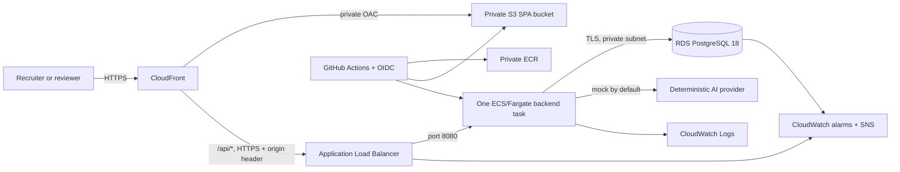

# Phase 9 Cloud Architecture

Status: Stage A design and infrastructure code only. No AWS resource, domain,
public endpoint, or paid model was provisioned.

## Recommended managed portfolio architecture

The browser sees one origin: `https://stockflow.<domain>`. CloudFront serves
immutable frontend assets from a private S3 bucket and routes `/api/*` to the
backend. This preserves the existing first-party session-cookie and CSRF model;
no production CORS exception is required.

The ALB accepts HTTPS only from the AWS-managed CloudFront origin prefix list.
It also requires a random origin-verification header before forwarding. The
Fargate task has a public IP only to avoid a continuously billed NAT Gateway;
its security group permits no public ingress. PostgreSQL is not public and
accepts port 5432 only from the backend security group.

### Deliberate scope

- One backend task matches the process-local session and login-throttle model.
  Deployments invalidate some sessions and provide less availability than two
  tasks. Horizontal scaling requires shared sessions and shared/edge throttling.
- Single-AZ RDS with seven-day backups is appropriate for a portfolio demo, not
  a high-availability production service. Multi-AZ is an explicit cost upgrade.
- The default provider is the deterministic mock. There is no public unlimited
  paid-model access and no live-provider test in CI.
- The outbox has no consumer, so no broker, NAT-dependent worker, or dispatcher
  is deployed.
- CloudFront, ALB, and RDS deletion protection are intentional. Teardown is a
  two-step reviewed operation with a final database snapshot.

## Options compared

| Option | Approximate monthly baseline | Strengths | Limitations | Decision |
|---|---:|---|---|---|
| S3/CloudFront + ECS/Fargate + ALB + private RDS | $88–95 | Strong AWS portfolio signal, managed database/backups, immutable images, private database, health rollback, native alarms | Highest idle cost; one task is not highly available; custom domain required for end-to-end TLS | **Prepared/recommended when the portfolio value justifies the budget** |
| Lightsail 2 GB instance + encrypted Lightsail managed database | $42–50 | Predictable lower cost, managed persistent database, simple Docker deployment | More manual patching/release recovery, fewer network/IAM controls, single application host | Reasonable lower-cost alternative if Stage B budget is capped |
| One Lightsail 2 GB instance with application and PostgreSQL together | $12–16 plus backups | Lowest cost, simple same-origin TLS | Shared failure domain, manual database recovery/patching, weaker isolation | Not recommended for a public write-capable demo |

Kubernetes, RabbitMQ, Redis, NAT Gateway, WAF, and multiple application tasks are
not justified by current demo traffic or architecture. AWS WAF can be added if
the URL is broadly advertised and abuse evidence warrants its recurring rule
and request charges.

## Runtime configuration

`application-prod.yml` requires production database values, encrypted database
transport, secure cookies, proxy-header processing, bounded Hikari timeouts,
graceful shutdown, hidden health details, and disabled public registration by
default. The task filesystem is read-only except for an ephemeral `/tmp` mount.
Secrets are injected from the RDS-managed Secrets Manager secret and never
placed in the image, Terraform variables, frontend, or logs.

The frontend is built with a blank `VITE_API_BASE_URL`, so it always uses the
same origin. CloudFront rewrites extensionless SPA routes to `index.html`, does
not cache `/api/*`, gives hashed assets long immutable caching, and applies CSP,
HSTS, frame, referrer, content-type, and permissions headers.

## Migrations and data

The one backend task runs Flyway before accepting traffic. ECS waits for the
readiness probe and has deployment-circuit-breaker rollback enabled, so a failed
migration/startup never replaces the last healthy task. Flyway's PostgreSQL
locking prevents simultaneous migration execution, but schema changes must
still follow expand/contract compatibility before the service is scaled above
one task.

Applied migrations are immutable and forward-only. Before any destructive or
large migration: take a manual RDS snapshot, test restore into a separate
instance, record expected lock/runtime, and obtain separate approval. Application
rollback does not reverse database schema automatically.

The demo account is created during a short, controlled bootstrap window. Public
registration is immediately disabled server-side. A one-off seed task inserts
only the checked-in `DEMO-*` synthetic dataset, then deterministic mock workflows
create an AI conversation, report, and unapproved restock proposals.

## Scaling path

At 100x demonstrated usage, first measure database CPU, connections, ALB p95,
task CPU/memory, and query plans. Then introduce two or more tasks with Spring
Session backed by a reviewed shared store, edge/shared throttling, RDS Multi-AZ
and a larger instance, autoscaling, and potentially read replicas. Add an outbox
relay only when a named consumer exists. Caching, queues, Redis, and service
extraction remain measurement-driven rather than default complexity.
