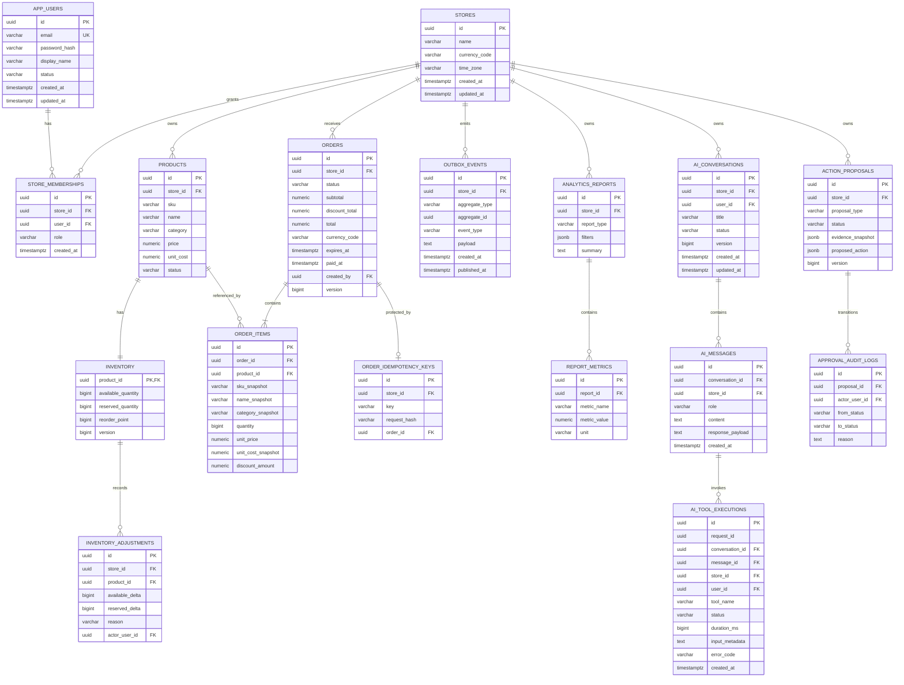

# Database Design

## Conventions

- UUID primary keys are generated by the application unless a migration explicitly supplies them.
- Timestamps are stored as `TIMESTAMPTZ` in UTC; the store time zone controls reporting boundaries.
- Money uses `NUMERIC(19,4)` plus an ISO 4217 currency code. One active currency is supported per store initially.
- Mutable records carry `created_at`, `updated_at`, and where useful optimistic `version` fields.
- Every tenant-owned query includes `store_id`; authorization never relies on an ID supplied by an AI tool or browser alone.

## Logical ER model

Flyway V1 creates `app_users`, `stores`, and `store_memberships`. Flyway V2 adds commerce tables. Flyway V3 adds immutable analytics snapshot columns and indexes. Flyway V4 adds AI conversations/messages/tool audits, V5 adds request telemetry, and V6 adds business-analysis report metadata plus JSONB documents. Approval/proposal entities remain later targets.

## Implemented commerce and analytics invariants and indexes

- Unique `lower(app_users.email)` prevents case-variant accounts.
- Unique `(store_id, user_id)` prevents duplicate memberships.
- Unique `(store_id, sku)` supports store-local identity and SKU lookup.
- Check inventory quantities are nonnegative; atomic reservation updates require `available_quantity >= requested`.
- Unique `(store_id, key)` on idempotency keys prevents duplicate order commands.
- `(store_id, status, created_at)` on orders supports dashboard/date/status scans.
- `(store_id, product_id, created_at)` on adjustments supports audit history.
- `(published_at, created_at)` on outbox events supports a later relay.
- Foreign keys and composite `(store_id, id)` uniqueness let inventory reference a product in the same store.
- Check constraints enforce nonnegative product amounts and inventory quantities, positive order item quantities, and allow-listed statuses.
- Order item snapshots preserve SKU, name, category, unit price, and unit cost even if a product changes later.
- Paid orders must have `paid_at`; non-paid states must not. This is the business timestamp for sales analytics.
- `(store_id, status, paid_at)` supports the dominant paid-order store/range scan. It is deliberately one composite index rather than several speculative indexes.
- `(order_id, product_id)` supports item joins and grouped product analytics (and complements the existing unique key).

Phase 4 overview/trend SQL first preserves order grain before joining or bucketing item quantities. Product/category revenue is aggregated from snapshot columns. Every analytics predicate includes authenticated `store_id`, an allow-listed paid status, and UTC-converted `[start, end)` bounds.

V3 backfills `paid_at` from terminal `updated_at` and category/cost snapshots from the catalog at migration time. That preserves queryability but cannot reconstruct a pre-migration category or unit cost that had already changed; the KPI documentation calls out this limitation and gross profit remains unsupported.

The idempotency row is inserted with `ON CONFLICT DO NOTHING` and then selected `FOR UPDATE`. It stores a SHA-256 hash of the canonical, product-ID-sorted request. The order ID is written only after the order is durable within the same transaction.

## Implemented Phase 5 persistence invariants and indexes

- Conversations carry both `store_id` and `user_id`; repositories require both columns for list/detail/update authorization.
- Conversation status is constrained to `ACTIVE|ARCHIVED`, and optimistic `version` prevents lost updates when the same conversation is changed concurrently.
- Messages are constrained to `USER|ASSISTANT`, are deleted with their conversation, and cap persisted content at 10,000 characters. Assistant `response_payload` stores the already validated structured response for exact replay.
- Tool audit rows identify the request, conversation, triggering user message, store, and user; status is `SUCCEEDED|FAILED` and duration cannot be negative.
- `input_metadata` contains only normalized allow-listed filters such as period, interval, and result limit. It intentionally excludes prompts, tenant identifiers supplied by a model, raw business result payloads, credentials, and session data.
- `(store_id, user_id, updated_at DESC)` serves the conversation list; `(conversation_id, created_at, id)` gives deterministic message order; request and owner indexes serve tool tracing/audit.
- Audit writes use a short `REQUIRES_NEW` transaction so a failed provider/tool turn cannot erase the diagnostic row. A successful assistant payload and its conversation touch commit together.

## Implemented Phase 5.5 telemetry invariants and indexes

- Flyway V5 adds `ai_request_telemetry`.
- Each request ID is unique and linked to its conversation, triggering user message, store, and user. Owner/time and status/time indexes support bounded operational investigations.
- Status is `SUCCEEDED|FAILED`; tool count and duration are nonnegative. Token fields are either all absent or nonnegative with `total >= input + output`; estimated cost cannot be negative.
- Telemetry stores provider/model, provider-reported usage, estimated cost plus pricing version, tool count, latency, and safe error code. It excludes prompt, response, result payload, cookie, and credential data.
- Cost is an estimate, not billed cost. A model without an exact configured price retains token counts with a null estimate.
- Phase 6 synthesis usage is also snapshotted on its owned report record because it does not belong to a chat conversation.

## Implemented Phase 6 report invariants and indexes

- Flyway V6 adds `business_analysis_reports` with relational owner, lifecycle, type, current/comparison period, freshness, model usage/cost, idempotency, version, and retention metadata plus a JSONB report document.
- A store/creator/idempotency unique key and SHA-256 request hash make retries replay-safe and reject key reuse with different input.
- Status is constrained to `PENDING|RUNNING|COMPLETED|FAILED`. Only completed rows require a non-null report document and completion timestamp; failed rows retain a safe failure code without fabricated content.
- `(store_id, created_at DESC, id)` serves ADMIN history; `(store_id, created_by_user_id, created_at DESC, id)` serves STAFF history; `(store_id, status, created_at DESC, id)` serves filtered lifecycle views.
- Hibernate validates the PostgreSQL JSONB column. The completed document is deserialized and referentially validated again on retrieval.
- `retention_until` defaults from configurable 90-day application policy, but no automatic deletion is implemented or approved.
- See [report schema](report-schema.md) for document invariants.

## Later target indexes

- `(store_id, status, created_at)` on proposals supports approval queues.
