# Phase 7 Restock Proposal Architecture

Status: implemented in Phase 7. Flyway V8/V9, the `operations` backend feature,
the bounded restock selector, and the React Operations workspace implement this
design. Supplier purchasing and forecasting remain explicitly excluded.

## Scope and non-goals

Phase 7 may turn an inventory-risk recommendation from a completed, authorized
Phase 6 report into a restock proposal. A proposal is not an order and approval
is not execution. Only an explicit, authorized execution command may call a
deterministic commerce service.

This phase does not add historical inventory forecasting, causal inference,
demand elasticity, autonomous purchasing, supplier integration, or arbitrary
model-authored actions. Current stock divided by selected-period paid-sales
velocity remains a descriptive coverage estimate, not a forecast.

## Required dependencies

Phase 7 depends on:

- a `COMPLETED`, version-validated Phase 6 report accessible to the authenticated
  actor;
- a recommendation and evidence references contained in that same immutable
  report;
- an active, store-owned product and current `InventoryBalance` with its existing
  version and `updatedAt` fields;
- the atomic inventory adjustment and inventory audit facilities;
- server-derived `StoreContext`, CSRF protection, Problem Details errors, and
  PostgreSQL transactions;
- closure of the stranded-report and relational/JSONB consistency gaps in
  [the readiness review](phase7-readiness-review.md).

The existing inventory adjustment does not accept an expected balance version.
Phase 7 needs a conditional, store-scoped command such as
`receiveRestock(storeId, productId, quantity, expectedVersion, actor, commandId)`
rather than reading and then invoking the generic adjustment path.

There is no supplier or purchase-order domain. The initial executable operation
must therefore mean **confirm a physically received restock and increase
available inventory**. If the product requirement instead means placing an
order with a supplier, Phase 7 must first add suppliers, purchase orders,
receipts, and their lifecycle; approval must never pretend unreceived stock is
available.

## Domain objects

`RestockProposal` should store relational, searchable fields rather than an
opaque model document:

- proposal ID, store ID, creator user ID, product ID, and status;
- source report ID/version, recommendation ID, evidence IDs, and an evidence
  hash;
- proposed quantity, reason code, and bounded human note;
- captured available/reserved quantities, reorder point, inventory version,
  inventory `updatedAt`, report `dataAsOf`, and proposal creation time;
- approver/rejector identity, decision time, decision reason, approved proposal
  version, and optional approval expiry;
- execution command ID, execution timestamps, resulting inventory adjustment
  ID/version, and safe failure code;
- provider/model, provider-reported token usage, versioned estimated cost, and
  proposal-generation latency; these are telemetry, not billed cost;
- optimistic `version`, created/updated timestamps, and no model credentials,
  prompts, or raw business rows.

Append-only `RestockProposalEvent` records every state transition. A separate
`RestockExecutionAttempt` records each claim, retry, outcome, latency, safe
error code, and command ID. These records provide workflow auditability without
using logs as the system of record.

## State machine

```mermaid
stateDiagram-v2
    [*] --> PROPOSED
    PROPOSED --> APPROVED: ADMIN approves exact version
    PROPOSED --> REJECTED: ADMIN rejects
    PROPOSED --> CANCELLED: creator or ADMIN cancels
    APPROVED --> EXECUTING: ADMIN executes; freshness passes
    APPROVED --> STALE: freshness or approval validity fails
    APPROVED --> CANCELLED: ADMIN cancels before execution
    EXECUTING --> EXECUTED: inventory and audit commit atomically
    EXECUTING --> FAILED: classified execution failure
    EXECUTING --> APPROVED: expired lease; no effect committed
    FAILED --> EXECUTING: explicit ADMIN retry; freshness passes
    FAILED --> STALE: retry freshness fails
    EXECUTED --> [*]
    REJECTED --> [*]
    CANCELLED --> [*]
    STALE --> [*]
```

Transitions use a database row lock or conditional status/version update. A
request against the wrong state returns a stable conflict, not an implicit
transition. Editing quantity, product, or evidence creates a new proposal (or
new proposal version) and invalidates prior approval. `STALE`, `REJECTED`,
`CANCELLED`, and `EXECUTED` are terminal; users create a new proposal from fresh
evidence rather than reopening history.

`EXECUTING` is a bounded lease, not an indefinite state. The execution owner and
lease expiry are persisted. Recovery may return an expired claim to `APPROVED`
only after proving that no inventory adjustment with the proposal command ID
committed. The compare-and-set recovery update must not race a live worker.

## Human-in-the-loop workflow

1. An authenticated user selects a recommendation from an accessible completed
   report and proposes a positive, bounded quantity.
2. The server reloads the report through existing role/store authorization,
   validates the recommendation/evidence linkage, loads current product and
   inventory state, and persists `PROPOSED` plus an audit event.
3. An ADMIN reviews the exact product, quantity, evidence, current balance,
   freshness, assumptions, and risks. Approval records the ADMIN, timestamp, and
   exact proposal version. It does not change inventory.
4. An ADMIN submits a separate execute command with a new idempotency key and an
   explicit confirmation that stock was received.
5. The server reauthorizes, revalidates freshness, claims execution, calls the
   deterministic inventory command, writes inventory/proposal audits and an
   outbox event, and commits as one PostgreSQL transaction.

With the current two roles, same-person ADMIN approval is allowed so a
single-admin store is usable, but proposal and approval remain separate,
explicit actions and both actors are recorded. A future dual-control policy can
require `approver != creator` without changing the state model.

The model never approves, executes, selects a store, supplies authorization, or
enters the execution transaction. Provider failure cannot block approval or
execution of an already-created valid proposal.

## Inventory freshness validation

Creation captures the inventory version and exact values used by the proposal.
Approval performs a preview check; execution repeats all checks inside the
authoritative transaction. Required execution checks are:

- proposal is `APPROVED`, approval refers to the current proposal version, and
  any configured approval expiry has not passed;
- authenticated store owns the proposal, product, source report, and inventory;
- source report is still `COMPLETED`, schema-valid, and the referenced
  recommendation/evidence IDs still exist;
- product remains active;
- current inventory version, `updatedAt`, available quantity, reserved quantity,
  and reorder point match the approved snapshot;
- report/proposal age is within a configurable freshness window;
- rerunning the existing deterministic current-risk calculation does not make
  the proposal inapplicable;
- positive quantity and post-adjustment numeric bounds remain valid.

Any mismatch marks the proposal `STALE` with a machine-readable reason. The
system does not silently recalculate quantity, auto-approve a changed proposal,
or use a client/model assertion to bypass freshness.

## Idempotent operational execution

- Require `Idempotency-Key` for proposal creation and execution. Store a
  normalized request hash; a reused key with a different payload is a conflict.
- Uniquely constrain `(store_id, proposal_id, execution_key)` and make the
  inventory audit reference a unique proposal command ID.
- Use one PostgreSQL transaction for the conditional expected-version inventory
  increment, inventory audit, proposal `EXECUTED` transition, proposal event,
  successful attempt, and outbox event. They all commit or all roll back.
- Do not call an LLM or external supplier inside this transaction.
- A replay returns the persisted execution result and never increments stock
  twice. A concurrent different execution command loses the proposal state or
  inventory version compare-and-set.
- The outbox atomically and durably records the event, but there is currently no
  relay or delivery guarantee because no consumer exists. A future at-least-once
  relay requires bounded retries and consumers that deduplicate event/command
  IDs; it is not required for the synchronous inventory commit.

## Authorization

| Operation | STAFF | ADMIN |
|---|---|---|
| Create proposal | From a completed report the STAFF user owns | From any completed report in the store |
| List/detail | Creator-owned proposals only | All proposals in the store |
| Cancel `PROPOSED` | Own proposal | Any store proposal |
| Approve/reject | Denied | Allowed after server revalidation |
| Execute/retry | Denied | Allowed after server revalidation |
| Read audit | Own visible proposal | Any store proposal |

Every query includes authenticated `store_id`; STAFF queries also include
creator ID. Client-supplied store/user/role values are absent. Unauthorized and
cross-store IDs return not found. Approval/execution methods check role in the
service layer even if routes and UI controls are also restricted.

## Audit logging

The proposal event ledger records proposal ID, store ID, from/to state, actor,
actor role, action, reason code, request/correlation ID, proposal version, and
timestamp. Execution attempts additionally record the idempotency command ID,
lease, result, inventory adjustment ID/version, latency, retry number, and safe
failure classification.

Audit writes for successful operations share the business transaction. A
failed execution attempt is recorded in a short independent transaction after
the business transaction rolls back. Audit payloads exclude credentials,
session IDs, prompts, raw provider messages, and unrestricted report content.
Inventory's existing adjustment ledger remains the authoritative stock delta
history and links back to the proposal command.

## Retry and failure handling

- Validation, authorization, stale evidence, inactive product, payload conflict,
  and state conflict are non-retryable.
- Optimistic conflicts return `409`; the caller must reload before an explicit
  retry. They do not trigger hidden approval or execution loops.
- A small bounded retry may cover classified PostgreSQL serialization/deadlock
  failures only because the command is idempotent. The retry owner and maximum
  attempts must be singular and configured.
- `FAILED` retains no partial stock mutation. Only an ADMIN can explicitly retry,
  using a new request while the server preserves the original proposal command
  identity and reruns freshness checks.
- Expired `EXECUTING` leases are reconciled in bounded batches. Recovery first
  searches for the unique committed inventory adjustment/result; it finalizes
  `EXECUTED` if found, otherwise returns the claim to `APPROVED` with an audit
  event. It never blindly repeats a side effect.
- Metrics cover proposal counts by state, transition failures, stale reasons,
  execution latency, retry count, and expired leases. Logs use identifiers and
  safe codes, not business report bodies.

## Persistence and retrieval shape

Flyway V8 adds relational `restock_proposals`, `restock_proposal_events`, and
`restock_execution_attempts` tables after acceptance of the API/state model.
Its indexes match these paths:

- ADMIN list: `(store_id, created_at DESC, id)`;
- STAFF list: `(store_id, created_by_user_id, created_at DESC, id)`;
- work/recovery: `(status, execution_lease_until, id)`;
- source trace: `(store_id, source_report_id, recommendation_id)`;
- unique create and execute idempotency constraints.

Do not add JSONB state, a queue, Redis locks, or a new service. PostgreSQL is the
coordination boundary. A queue becomes justified only if measured execution
latency or an external supplier integration requires asynchronous work.

Implemented APIs are generate/list/detail, approve, reject, cancel, execute, and
history endpoints under `/api/restock-proposals`. Generation and execution
require idempotency keys; every mutation requires CSRF and validation. `FAILED`
execution can be explicitly retried through the execute endpoint with a fresh
command ID after the UI reloads the current proposal version.

## Required Phase 7 tests

- state-transition table and invalid-transition tests;
- anonymous, STAFF/ADMIN, same-store creator, and cross-store authorization;
- approval against an exact proposal version and invalidation after edits;
- changed inventory version/value, inactive product, old evidence, and changed
  risk classification becoming `STALE`;
- same-key replay, changed-payload conflict, concurrent execute, and exactly one
  inventory increment/audit/outbox event;
- rollback after injected failures at each transactional write;
- failed attempt recording and bounded transient retry;
- process interruption/expired lease recovery before and after a committed
  idempotent result;
- AI/provider outage while approving/executing an existing proposal;
- UI role controls, stale/conflict messaging, confirmation, and double-submit
  protection;
- a real-stack flow from completed report to proposal, approval, confirmed
  receipt, inventory audit, and replay.

Phase 7 is complete under the verified mock-provider boundary. Real OpenAI
restock selection remains unverified because no billable live run was approved.

Phase 8 preserves this boundary and adds request correlation, bounded workflow
waits, repeated stale-validation coverage, concurrent order replay and terminal
transition tests, and real-stack negative workflow coverage. No relay was added:
the outbox remains an atomic durable record without external delivery because
the application still has no event consumer.
